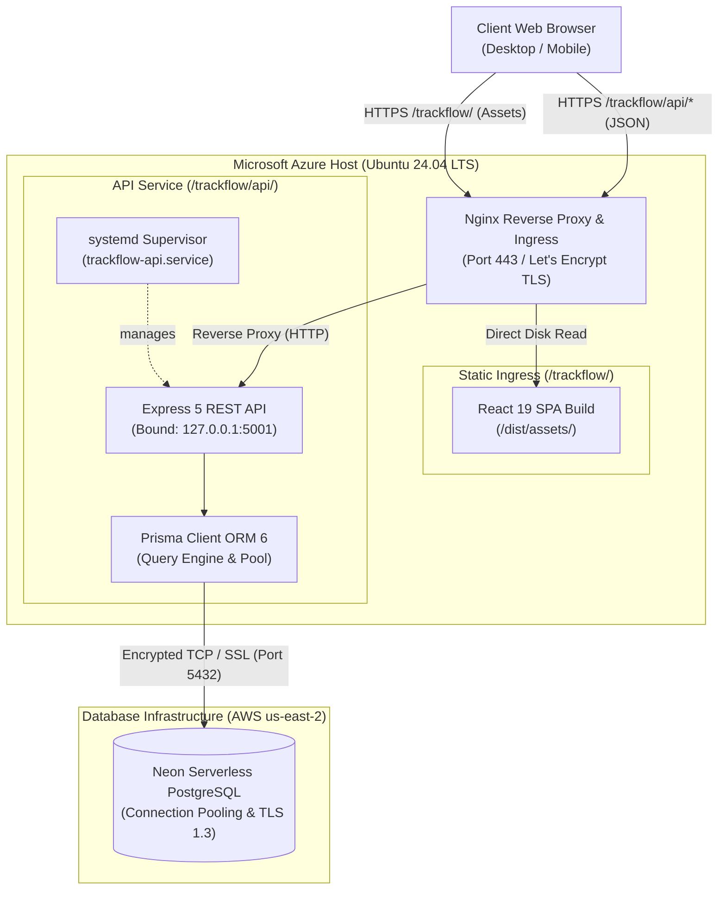
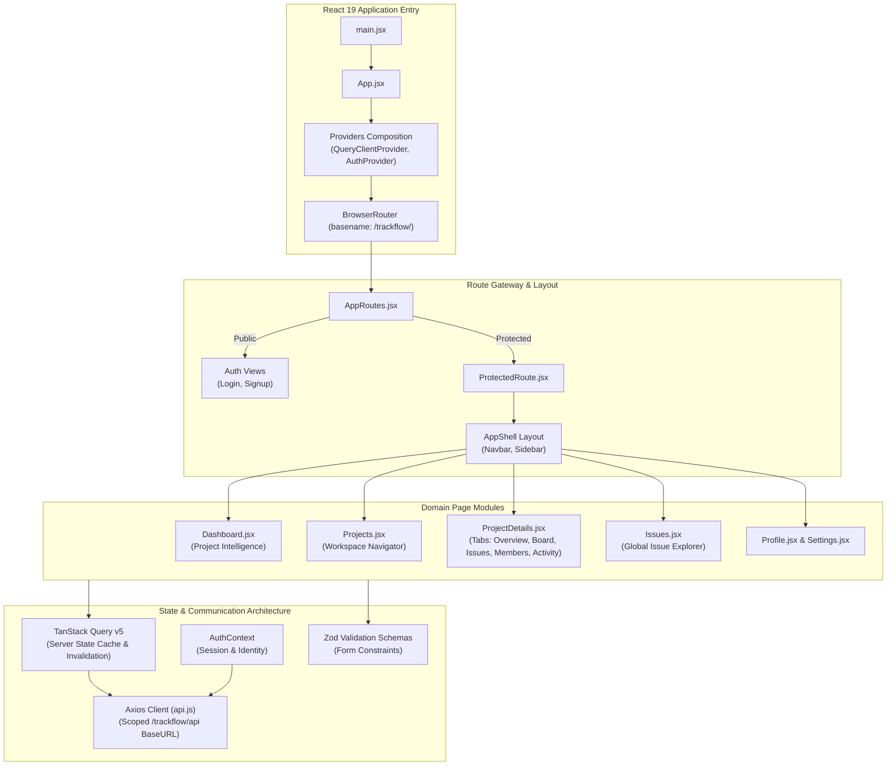
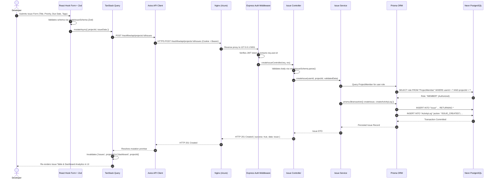
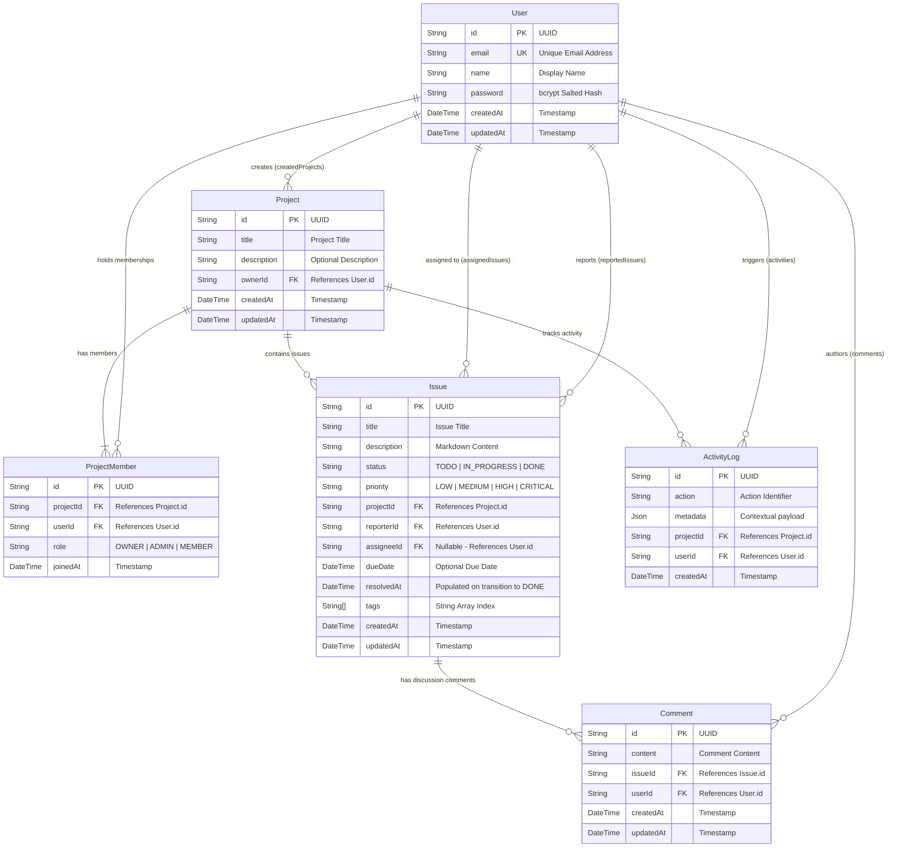
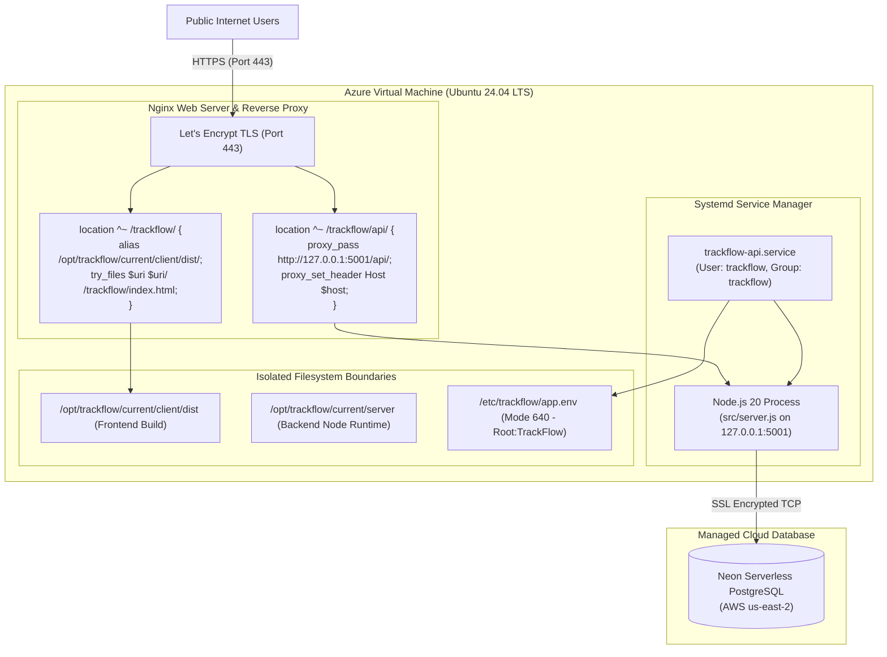

# TrackFlow — System Architecture & Engineering Specification

> Comprehensive architecture specification, system context, component diagrams, request lifecycles, and engineering design rationales for TrackFlow — Issue Tracking & Project Intelligence Platform.

---

## 1. System Context & High-Level Architecture

TrackFlow is engineered as a decoupled, multi-tier system separating presentation, API routing, business domain logic, and relational persistence. In production on Microsoft Azure, the application runs behind an Nginx reverse proxy providing TLS termination and path-based ingress routing.



### Component Responsibilities

| Tier / Component | Responsibilities | Security Boundaries |
| :--- | :--- | :--- |
| **Client UI (React 19)** | Presentation, client-side route navigation, form state, reactive charting, debounced query filtering, optimistic feedback. | Operates in untrusted client space. Sensitive claims stripped; zero raw secrets stored. |
| **Ingress (Nginx 1.24)** | TLS termination, static asset compression (`gzip`), long-term HTTP caching (`1y immutable` for hashed assets), SPA history fallback, reverse proxy to Express. | Drops unapproved HTTP methods; hides internal backend sockets from external network. |
| **API Gateway (Express 5)** | Security headers, scoped cookie parsing, rate limiting, CORS origin enforcement, JWT authentication verification. | Enforces `trust proxy 1`; strictly validates request origins and HTTP request envelopes. |
| **Service Layer** | Project-level RBAC enforcement (`OWNER`, `ADMIN`, `MEMBER`), transactional mutations, activity audit logs, cycle-time calculations. | Disregards client-submitted user IDs; derives identity solely from cryptographically verified JWT claims. |
| **Data Layer (Prisma & Neon)** | Connection pooling, schema validation, foreign key integrity, concurrent analytical aggregations. | Enforces SSL encryption (`sslmode=require`); isolated schema with targeted composite indexes. |

---

## 2. Frontend Architecture

The frontend is built on React 19, Vite, and Tailwind CSS 4. Server state is synchronized via TanStack Query v5, eliminating ad-hoc global stores while maintaining surgical cache invalidation.



### Cache Key Structure & Multi-Query Invalidation Strategy

TanStack Query uses hierarchical array keys to isolate domain entities:

```javascript
['projects']                             // All accessible projects
['projects', projectId]                  // Project metadata
['projects', projectId, 'members']       // Project collaborator roster
['issues', projectId, { status, priority }] // Scoped & filtered project issues
['all-issues', { search, status }]       // Workspace-wide issue search
['issues', issueId]                      // Issue detail & attributes
['comments', issueId]                    // Discussion thread
['dashboard', projectId]                 // Project Intelligence metrics
['activity', projectId]                  // Real-time chronological audit trail
```

---

## 3. Backend Layered Architecture

The backend implements a strict unidirectional layered architecture:
`HTTP Request → Middleware → Routes → Controllers → Services → Prisma ORM → PostgreSQL`.

```mermaid
graph TD
    Req["Incoming HTTP Request"] --> ExpressApp["Express Application (app.js)"]
    
    subgraph MiddlewarePipeline["Middleware Pipeline"]
        SecHeaders["Security Headers (X-Frame, HSTS, nosniff)"]
        CORS["CORS Verification (Allowed Origins Allowlist)"]
        Parsers["Parsers (express.json, cookieParser)"]
        AuthMid["authMiddleware.js (JWT Verification &amp; req.user injection)"]
    end

    ExpressApp --> SecHeaders --> CORS --> Parsers --> AuthMid

    subgraph RouteLayer["Route Gateway (src/routes/)"]
        AuthRoutes["auth.routes.js"]
        ProjectRoutes["project.routes.js"]
        IssueRoutes["issue.routes.js"]
        DashboardRoutes["dashboard.routes.js"]
        CommentRoutes["comment.routes.js"]
        ActivityRoutes["activity.routes.js"]
    end

    AuthMid --> RouteLayer

    subgraph ControllerLayer["Controllers &amp; Validation (src/controllers/)"]
        ZodParse["Zod Validation<br/>(Schema parse &amp; sanitization)"]
        ControllerExec["Controller Execution<br/>(HTTP Response Envelope Mapping)"]
    end

    RouteLayer --> ZodParse --> ControllerExec

    subgraph ServiceLayer["Domain &amp; Business Logic (src/services/)"]
        RBAC["RBAC Verification<br/>(ProjectRole: OWNER, ADMIN, MEMBER)"]
        BusinessRules["Domain Business Rules<br/>(Cycle time, resolvedAt, state validation)"]
        AuditLogging["Activity Audit Logger<br/>(ActivityLog generation)"]
    end

    ControllerExec --> RBAC --> BusinessRules --> AuditLogging

    subgraph PersistenceLayer["Data Persistence (src/prisma/)"]
        PrismaTx["Prisma $transaction &amp; Client API"]
        NeonDB[("Neon PostgreSQL Database")]
    end

    BusinessRules --> PrismaTx
    AuditLogging --> PrismaTx
    PrismaTx --> NeonDB
```



---

## 4. Request Lifecycle: Issue Creation

Below is the concrete end-to-end execution path for creating an issue within a project:



---

## 5. Authentication & Authorization Flow

TrackFlow utilizes a defense-in-depth authentication model combining salted password hashing, stateless JSON Web Tokens, partitioned cookies, and project-scoped Role-Based Access Control.

```mermaid
sequenceDiagram
    autonumber
    actor Client as Web Browser
    participant API as Express Auth API
    participant Bcrypt as bcrypt (10 rounds)
    participant JWT as jsonwebtoken
    participant Svc as Auth / Project Service
    participant DB as PostgreSQL Database

    Note over Client, DB: User Registration (Signup)
    Client->>API: POST /api/auth/signup { name, email, password }
    API->>Bcrypt: Hash password (10 salt rounds)
    Bcrypt-->>API: $2b$10$... (Salted Hash)
    API->>DB: INSERT INTO "User" (name, email, password)
    DB-->>API: Persisted User Record
    API->>JWT: sign({ id, email, name }, JWT_SECRET, { expiresIn: '7d' })
    JWT-->>API: JWT Token String
    API-->>Client: Set-Cookie: trackflow_token=...; Path=/trackflow; HttpOnly; Secure; SameSite=Lax<br/>HTTP 201 Created { token, user }

    Note over Client, DB: Authenticated API Request & RBAC Verification
    Client->>API: GET /api/projects/:projectId/issues (with Cookie / Bearer Token)
    API->>JWT: verify(token, JWT_SECRET)
    JWT-->>API: Decoded claims { id: userId, email: ... }
    API->>Svc: getProjectIssues(userId, projectId)
    Svc->>DB: SELECT role FROM "ProjectMember" WHERE userId = ? AND projectId = ?
    alt User is not a member of project
        DB-->>Svc: null
        Svc-->>API: Error 403 Forbidden ("Access denied to project")
        API-->>Client: HTTP 403 Forbidden
    else User is MEMBER, ADMIN, or OWNER
        DB-->>Svc: Role: "OWNER"
        Svc->>DB: SELECT * FROM "Issue" WHERE projectId = ? ORDER BY createdAt DESC
        DB-->>Svc: Issue Records
        Svc-->>API: Sanitized Issue List
        API-->>Client: HTTP 200 OK { success: true, data: issues }
    end
```

### Role-Based Access Control (RBAC) Matrix

| Operation | `OWNER` | `ADMIN` | `MEMBER` | Outsider |
| :--- | :---: | :---: | :---: | :---: |
| **View Project Overview & Dashboard** | Full | Full | Full | Denied (403) |
| **Create Issue** | Allowed | Allowed | Allowed | Denied (403) |
| **Update Issue Status & Priority** | Allowed | Allowed | Allowed | Denied (403) |
| **Assign / Reassign Issues** | Allowed | Allowed | Allowed | Denied (403) |
| **Post Comments** | Allowed | Allowed | Allowed | Denied (403) |
| **Delete Any Issue** | Allowed | Allowed | Denied (403) | Denied (403) |
| **Invite & Add Collaborators** | Allowed | Allowed | Denied (403) | Denied (403) |
| **Promote / Change Member Roles** | Allowed | Denied (403) | Denied (403) | Denied (403) |
| **Transfer Ownership / Delete Project** | Allowed | Denied (403) | Denied (403) | Denied (403) |

---

## 6. Database Entity-Relationship Architecture

The relational schema is defined in Prisma ORM targeting PostgreSQL. Every project is isolated through foreign key relationships and composite unique constraints.



### Composite Indexes & Optimization

To avoid full table scans during filtering and analytical aggregations, the following composite indexes are defined:

- `@@index([projectId, status])` on `Issue` — Optimizes Kanban column reads and status metric calculations.
- `@@index([projectId, priority])` on `Issue` — Accelerates priority distribution queries.
- `@@index([projectId, assigneeId])` on `Issue` — Powers team workload distribution aggregations.
- `@@index([projectId, createdAt])` on `ActivityLog` — Accelerates chronological project audit timeline retrieval.
- `@@unique([projectId, userId])` on `ProjectMember` — Enforces membership cardinality and instant RBAC lookups.

---

## 7. Project Intelligence Analytics Data Flow

The Project Intelligence Dashboard aggregates delivery velocity, workload, resolution times, and risk metrics in real-time without background batch processing:

```mermaid
graph LR
    subgraph ClientTrigger["Client Presentation"]
        UserAction["User Selects Active Project"] --> Hook["useDashboard(projectId)"]
        Hook --> APIReq["GET /api/projects/:id/dashboard"]
    end

    subgraph ServiceAggregation["Backend Dashboard Service"]
        APIReq --> Svc["dashboard.service.js"]
        
        subgraph ConcurrentQueries["Parallel Database Aggregations (Promise.all)"]
            Q1["Issue Status Counts<br/>(TODO, IN_PROGRESS, DONE)"]
            Q2["Priority Breakdown<br/>(LOW, MED, HIGH, CRIT)"]
            Q3["Cycle Time Calculation<br/>(AVG resolvedAt - createdAt)"]
            Q4["Overdue &amp; Stale Tasks<br/>(dueDate &lt; NOW &amp; status != DONE)"]
            Q5["Team Workload Grouping<br/>(groupBy assigneeId)"]
        end

        Svc --> ConcurrentQueries
        ConcurrentQueries --> Assembler["Metric Payload Assembler"]
    end

    subgraph Visualization["Client Render Engine"]
        Assembler --> HTTPResponse["HTTP 200 JSON"]
        HTTPResponse --> TanStack["TanStack Query Cache"]
        TanStack --> StatsCards["Overview Stat Cards"]
        TanStack --> StatusPie["Status Distribution (Donut Chart)"]
        TanStack --> PriorityBar["Priority Breakdown (Bar Chart)"]
        TanStack --> WorkloadBar["Workload Distribution (Horizontal Bars)"]
    end
```



---

## 8. Production Deployment Architecture

The application is deployed on Microsoft Azure alongside existing services using strict isolation:



### Path Isolation & Cookie Scoping

- **Frontend Path:** Served under `/trackflow/` with HTML5 client-side routing fallback.
- **API Path:** Reverse proxied under `/trackflow/api/` to `127.0.0.1:5001`.
- **Cookie Scope:** `trackflow_token` scoped with `Path=/trackflow; HttpOnly; Secure; SameSite=Lax` to prevent state collision with root host applications.
- **Nginx `^~` Prefix Modifier:** Ensures Vite-hashed static assets (`/trackflow/assets/*`) bypass generic root regex caching rules.

---

## 9. Repository Structure

```
TrackFlow/
├── .github/                     # GitHub workflows and repository configurations
├── client/                      # React 19 Frontend Application
│   ├── public/                  # Static web assets (favicon, icons)
│   ├── src/
│   │   ├── assets/              # Fonts, styles, bundled graphic assets
│   │   ├── components/          # Domain & UI component hierarchy
│   │   │   ├── activity/        # ActivityItem, ActivityTimeline
│   │   │   ├── comment/         # CommentItem, CommentList
│   │   │   ├── issue/           # IssueTable, IssueRow, IssueFilters, IssueFormDialog
│   │   │   ├── kanban/          # KanbanBoard, KanbanColumn, KanbanCard
│   │   │   ├── layout/          # AppShell, Navbar, Sidebar
│   │   │   ├── project/         # ProjectCard, ProjectMembersTab, OverviewTab
│   │   │   └── ui/              # Radix/Base-UI atomic primitives (Button, Dialog, Avatar)
│   │   ├── context/             # AuthContext & Session management
│   │   ├── hooks/               # Custom query and mutation hooks (TanStack Query)
│   │   ├── pages/               # Top-level route pages (Dashboard, Projects, Issues, Profile)
│   │   ├── routes/              # AppRoutes & ProtectedRoute route guards
│   │   ├── services/            # Axios API transport layer
│   │   └── validations/         # Zod schemas for client form validation
│   ├── .env.example             # Safe frontend environment template
│   ├── package.json             # Frontend dependency manifest
│   └── vite.config.js           # Vite build & base path configuration
├── docs/                        # Architectural documentation & media assets
│   ├── assets/                  # High-resolution vector diagrams and banners
│   ├── screenshots/             # Production UI screenshots
│   └── architecture.md          # Comprehensive architecture specification
├── server/                      # Express 5 REST API Backend
│   ├── prisma/
│   │   ├── migrations/          # Version-controlled SQL migration history
│   │   ├── schema.prisma        # Canonical data models, relations & indexes
│   │   └── seed.js              # Realistic domain seed dataset
│   ├── src/
│   │   ├── config/              # Prisma client, JWT, and runtime configurations
│   │   ├── controllers/         # HTTP controller handlers & envelope mapping
│   │   ├── middleware/          # Auth, CORS, rate limiting, and error handlers
│   │   ├── routes/              # Express API route modules
│   │   ├── services/            # Domain logic, RBAC, analytics & audit logging
│   │   ├── validations/         # Zod schemas for backend request validation
│   │   ├── app.js               # Express application initialization & middleware stack
│   │   └── server.js            # HTTP server lifecycle & graceful shutdown
│   ├── tests/                   # Integration and security test suites
│   ├── .env.example             # Safe backend environment template
│   └── package.json             # Backend dependency manifest
├── .gitignore                   # Comprehensive repository ignore rules
└── README.md                    # Primary repository introduction & portfolio showcase
```

---

## 10. Architectural Decisions & Design Rationales

### 1. Why PostgreSQL over NoSQL?
TrackFlow’s core domain revolves around strict relational constraints: projects contain issues, issues belong to projects and members, comments bind to issues, and membership requires project-specific authorization roles (`ProjectMember`). PostgreSQL guarantees ACID transactions, referential integrity via foreign key cascading, and database-level aggregations (`AVG`, `COUNT`, `GROUP BY`) essential for the Project Intelligence metrics.

### 2. Why Prisma ORM?
Prisma provides a single source of truth (`schema.prisma`) for data models, migrations, and TypeScript-ready query definitions. Its `$transaction` API guarantees that complex operations (such as creating an issue while simultaneously generating an activity log entry) execute atomically.

### 3. Why a Layered Backend (Routes → Controllers → Services → ORM)?
Separating HTTP transport concerns (status codes, headers, cookie parsing) from domain logic (RBAC, cycle time calculations) ensures:
- **Testability:** Domain logic can be unit-tested without mocking Express `req` and `res`.
- **Maintainability:** Modifying API schema contracts does not ripple through business logic.
- **Reusability:** Services can be invoked from multiple controllers or background cron handlers without duplicating validation or authorization checks.

### 4. Why `ProjectMember` as an Explicit Join Entity?
Instead of storing a flat array of user IDs on `Project`, `ProjectMember` reifies the many-to-many relationship into a first-class domain entity containing the user's role (`OWNER`, `ADMIN`, `MEMBER`) and join timestamp. This enables users to possess different permission tiers across different projects within the same organization.

### 5. Why TanStack Query v5?
Traditional Redux or Context patterns force developers to manage loading states, cache invalidation, deduplication, and synchronization manually. TanStack Query treats server state as a distinct entity, automatically managing background refetching, query caching, deduplication of concurrent requests, and surgical multi-query invalidations upon successful mutations.

### 6. Why Nginx and systemd on Linux?
- **Nginx:** Operates as a high-performance reverse proxy handling TLS encryption, HTTP/2 multiplexing, static asset caching with `immutable` headers, and SPA routing fallback (`try_files $uri /trackflow/index.html`).
- **systemd:** Provides process supervision, automated restart on failure (`Restart=on-failure`), environment injection from secured files (`640` permissions), and isolation without the overhead of heavy container runtimes on modest VM hardware.
